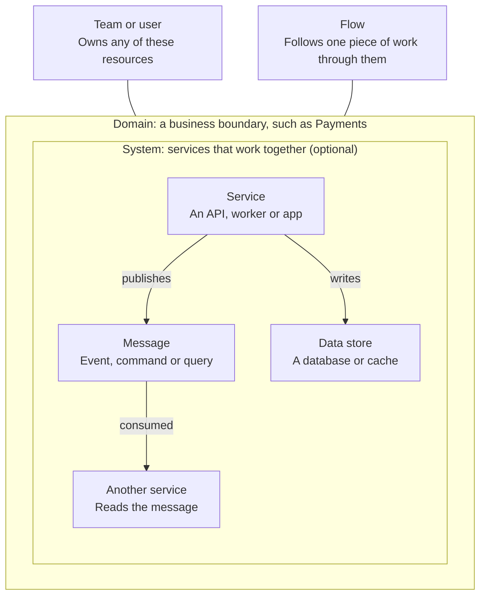
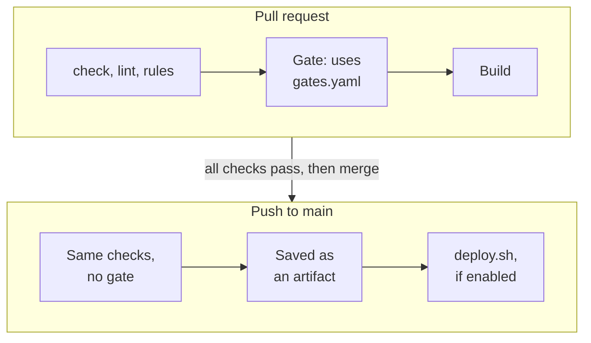

# How to Build an Architecture Catalog with DomainCatalog

A catalog is a Git repo of plain files that DomainCatalog builds into a searchable website. You describe your domains, services, messages and owners in Markdown, import your API specs, and let CI check every change before it publishes the site.

## Before you start

You need:

- Node 24, or Node 22.23.4 or later
- Git, plus a GitHub repo if you want the ready-made CI pipeline
- The DomainCatalog folder on your machine
- Your OpenAPI, AsyncAPI or GraphQL files, if you have them
- A list of your teams and the services each one owns

## Step 1: Create the catalog

Install the tool's dependencies once, then use `init` to create a new catalog.

```bash
cd ~/projects/domaincatalog
npm install
alias dc="node $PWD/src/cli.mjs"
```

The rest of this guide uses `dc` as shorthand. The alias only lasts for the current terminal, so add it to your shell profile to keep it.

```bash
dc init ~/projects/my-catalog
cd ~/projects/my-catalog
git init -b main
dc dev
```

Open http://localhost:3000 to see the site. It rebuilds whenever you save a catalog file. Use `dc dev --port 3001` if that port is taken.

`init` creates this starting point:

| Path | What it holds |
| --- | --- |
| `domaincatalog.config.js` | Site title, theme and other settings |
| `domains/` | A sample Orders domain, with a service and an event |
| `teams/`, `users/` | Sample owners |
| `guides/` | Free-form documentation |
| `gates.yaml` | Rules for which changes a pull request can't include |
| `.github/workflows/catalog.yml`, `deploy.sh` | The CI pipeline and your upload command |

Set `title` in `domaincatalog.config.js`, and delete the sample Orders domain, team and user once your real content is in.

## Step 2: Plan before you write

Start with one domain that a single team knows well, and finish it before starting the next. A small, accurate catalog earns more trust than a large one full of guesses.



Every block is optional, so model only what helps your readers. A domain can hold services directly, without a system in between. Your catalog can also hold entities (business objects like Order), channels (like a Kafka topic), datasets, decision records and diagrams.

Work through them in this order:

1. Teams and users, so that everything has an owner
2. Your first domain
3. Its services and messages, imported from specs where you can
4. Its data stores and systems
5. One flow that matters to the business

A resource's type comes from its folder name, such as `events/` or `services/`, and nesting a folder inside another makes it part of that resource. Connections between resources come from the `id` values in their frontmatter, so they survive if you reorganize folders later.

## Step 3: Add teams, domains and services

Add owners first, so everything else can point at them. Every resource needs a unique `id`, and other files refer to it by that `id`.

```bash
dc add team --id payments-team --name Payments --summary "Owns taking and refunding payments"
dc add domain --id payments --name Payments --summary "Charges customers and handles refunds"
dc add service --id payment-service --name "Payment Service" --domain payments
dc add event --id payment-captured --name "Payment Captured" --service payment-service
```

`add` only covers events, commands, queries, services, domains and teams. Create everything else by hand, as a `resource.mdx` file in a folder named for its type, such as `domains/payments/systems/checkout/resource.mdx`. Users are single files, such as `users/ada.mdx`.

`add` creates the file but doesn't link anything up. To connect a service to its owner, messages and data store, edit its `resource.mdx`:

```yaml
---
id: payment-service
name: Payment Service
version: 1.0.0
summary: Talks to the card provider and records outcomes.
ownedBy:
  - payments-team
publishes:
  - id: payment-captured
consumes:
  - id: take-payment
writes:
  - id: payments-db
---

## Overview

Why this service exists, and anything a new team member should know.

<MessageList />

<Neighborhood />
```

The maps, the producer and consumer lists and the search all come from these fields, so you never draw them by hand.

## Step 4: Import your API specs

Importing is the fastest way to fill a catalog, because one file creates a service, its messages and their schemas.

```bash
dc generate openapi ../payment-service/openapi.yml --domain payments
dc generate asyncapi ../payment-service/asyncapi.yml --domain payments
dc generate graphql ../payment-service/schema.graphql --domain payments --service payment-graphql
```

The `--domain` must be the domain's `id`, and it's created if it doesn't exist. By default, the service `id` comes from the spec's title, so use `--service` if you want to choose it.

| Spec | Becomes |
| --- | --- |
| OpenAPI `GET` | A query the service consumes |
| OpenAPI `POST`, `PUT`, `PATCH`, `DELETE` | A command the service consumes |
| AsyncAPI 2 and 3 | Events the service publishes or consumes |
| GraphQL `Query`, `Mutation`, `Subscription` | A query, a command, and a published event |

To override a type, set `x-domaincatalog-kind` to `event`, `command` or `query` on an OpenAPI operation or an AsyncAPI message.

Three things to know before you re-import:

- **Versions:** a higher version in the spec moves the old one into `history/`, while a lower one is refused.
- **Hand edits:** a re-import replaces each imported message's file, including any owners and text you added there. The service keeps its text, but its `publishes` and `consumes` lists are replaced. Keep your own explanations on the service or in a guide.
- **Owners:** imports don't set owners, so `lint` warns until you add them.

## Step 5: Write what specs can't tell you

Specs say what an API does, but only your team knows why it exists, who owns it and how a request moves through the business. That's the part worth writing by hand.

### Link and show things

Link to any resource with `{{event:payment-captured}}`, a specific version with `{{event:payment-captured@1.0.0}}`, or custom text with `{{service:payment-service|the payment service}}`. Use `guide`, `spec` and `schema` as the type to link to those instead.

These components build themselves from your frontmatter:

| Component | What it shows |
| --- | --- |
| `<Neighborhood />` | This resource and what it connects to |
| `<MessageList />` | Messages a service or domain publishes and consumes |
| `<SchemaView file="schema.json" />` | A schema as a tree, plus the raw file |
| `<FlowMap id="order-to-door" />` | A flow, with its step-through walkthrough |
| `<EntityFields />` | An entity's properties |
| `<Callout type="tip">` | A highlighted note |

The [README](../README.md#writing-content) lists the full set. Custom React or Astro components aren't supported, and they render as plain content.

### Describe a flow

A flow shows how one piece of work crosses your services. Each step points at a resource or an actor, and `next` names the step after it. Give `next` a list where the flow branches, and the walkthrough lets readers choose a path.

```yaml
---
id: refund-a-payment
name: Refund a Payment
version: 1.0.0
summary: From a customer's request to the money returning.
ownedBy:
  - payments-team
steps:
  - id: customer
    title: Customer
    actor:
      name: Customer
    next:
      id: request
      label: Asks for a refund
  - id: request
    title: Refund requested
    message:
      id: refund-requested
    next:
      - id: approved
        label: Within policy
      - id: rejected
        label: Outside policy
  - id: approved
    title: Payment Service
    service:
      id: payment-service
  - id: rejected
    title: Refund rejected
---

<FlowMap />
```

Save it as `flows/refund-a-payment/resource.mdx`. This example also assumes a message with the `id` `refund-requested`.

### Add the rest

| To add | Where it goes |
| --- | --- |
| A schema | `schema.json` beside the message's `resource.mdx`, plus `schema: schema.json` in its frontmatter |
| A new version | Move the old `resource.mdx` and its files to `history/<old version>/`, then update the current one |
| Notes on what changed | `changes.mdx` beside `resource.mdx` |
| Runbooks for one resource | `pages/` inside that resource's folder |
| Guides for everyone | `guides/` at the top of the catalog, with `title` and `summary` |
| Your own home page | `site/index.mdx` |

## Step 6: Check the catalog

Run the first three commands before every pull request. They exit with an error on a blocking problem, which is what lets CI stop a merge.

| Command | What it catches |
| --- | --- |
| `dc check` | Broken references and duplicates. It also lists unknown owners and counts unowned resources, without failing on them |
| `dc lint` | Those problems plus missing files, summaries, owners and schemas |
| `dc rules` | Your own architecture rules |
| `dc gate --base <snapshot>` | Changes your `gates.yaml` doesn't allow |

In `dc lint`, errors fail the run and warnings don't. To change a rule's severity, add it to your config, such as `lint: { rules: { 'missing-owner': 'error' } }`. Each rule can be `off`, `warn` or `error`.

### Write an architecture rule

Any file named `*.rule.mjs` in the catalog is a rule. It returns a list of problems, and a rule that crashes is reported as errored rather than passed.

```js
export default {
  id: 'events-have-owners',
  title: 'Every event has an owner',
  severity: 'error',
  check({ catalog }) {
    return catalog.resources('event')
      .filter((event) => !event.ownerRefs.length)
      .map((event) => `${event.name} has no owner`);
  },
};
```

### Block breaking changes

A gate compares the catalog with a saved snapshot and applies the rules in `gates.yaml`:

```yaml
gates:
  - id: no-breaking-schemas
    when: schema_breaking
    severity: error
    message: Breaking schema change
  - id: announce-removals
    when: resource_removed
    severity: warn
```

The conditions are `resource_added`, `resource_removed`, `schema_changed`, `schema_breaking`, `owner_changed`, `deprecated`, `consumer_added`, `consumer_removed`, `producer_added` and `producer_removed`.

By default, a schema change counts as breaking if existing readers could fail: a removed field, a field that's no longer required, a new enum value, or a changed type or format. This only covers JSON Schema.

To try it locally, save a snapshot, make your change, then run the gate against that snapshot:

```bash
dc snapshot create
dc snapshot list
dc gate --base .domaincatalog/snapshots/<file>.snapshot.json
```

## Step 7: Set up CI and deploy

The pipeline `init` created checks every pull request and only publishes from `main`, so the live site changes only through a reviewed merge.



Any failed step stops the run. A failure only blocks merging once you make the checks required, which is the fifth step below.

To turn it on:

1. Put the DomainCatalog tool in a Git repo the pipeline can read, because that's how CI gets the tool.
2. Push your catalog to its own GitHub repo.
3. In the catalog repo's settings, add these:

    | Kind | Name | Value |
    | --- | --- | --- |
    | Variable | `DOMAINCATALOG_REPO` | The tool's repo, as `owner/name` |
    | Variable | `DOMAINCATALOG_REF` | Optional: a branch or tag. Defaults to `main` |
    | Secret | `DOMAINCATALOG_TOKEN` | If the tool's repo is private: a token that can only read it |

4. Open a test pull request, and confirm the checks run.
5. Make those checks required under branch protection.

After that, each merge saves the built site as a `catalog-site` artifact that you can download from the workflow run.

### Publish the site

The build creates a static site in `dist/`, so any static host works. To publish automatically:

1. Replace the placeholder in `deploy.sh` with your upload command:

    ```bash
    aws s3 sync "$SITE_DIR" s3://your-bucket --delete
    ```

2. Add any credentials as secrets, and pass them to the Deploy step in `.github/workflows/catalog.yml`.
3. Set the `CATALOG_DEPLOY` variable to `true`.
4. In `domaincatalog.config.js`, set `siteUrl` to the site's address, and `base` if it lives under a subpath.

The built site has no login. If your catalog is internal, host it behind your VPN or SSO proxy, and check who can read it before using a public service like GitHub Pages.

Pull requests run the catalog's `domaincatalog.config.js` and `*.rule.mjs` files in CI, so only accept changes to those from people you trust.

## Step 8: Keep it current

A catalog people stop trusting stops being used, so make updating it part of normal work.

- **Automate imports:** have each service's pipeline re-run `dc generate` when its spec changes, and open a pull request against the catalog.
- **Tie it to code changes:** make updating the catalog part of the definition of done for any change to a message or service.
- **Make gaps visible:** once owners are filled in, set `missing-owner` to `error` so that new resources can't merge without one.
- **Connect AI agents:** run `dc mcp` so agents can search the catalog, and point them at the `llms.txt` file each build creates.

## Known limits

| Area | Limit |
| --- | --- |
| Editing | The site is read-only. Every change goes through files and a deployment |
| Login | The built site has none, and `dc serve` only has HTTP Basic |
| Breaking changes | JSON Schema only, so no Avro or Protobuf |
| Imports | OpenAPI, AsyncAPI and GraphQL only, and GraphQL uses a simple parser |
| Map layouts | Moved boxes are saved per browser and aren't shared with your team |
| Testing | So far run only on small sample catalogs, and the pipeline hasn't yet run on GitHub |

[FEATURES.md](../FEATURES.md) has the full list.
